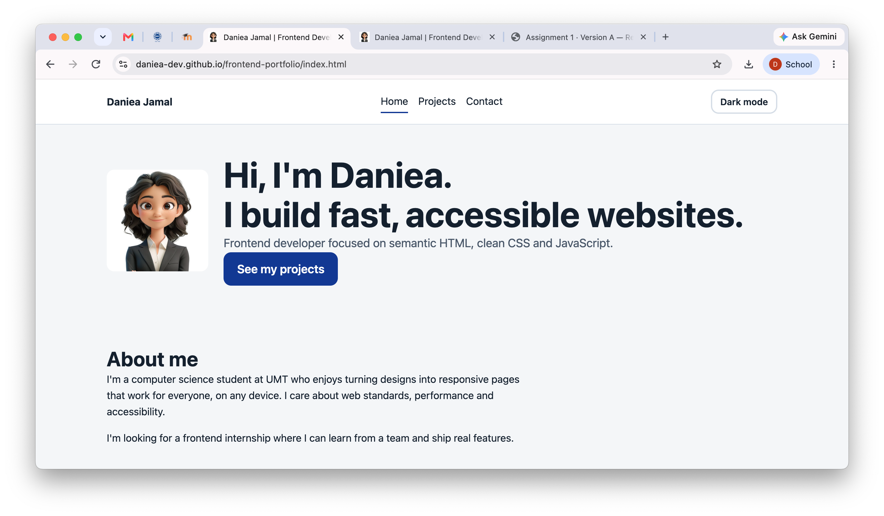

# Responsive Developer Portfolio

CS-554 Advanced Web Technologies, Assignment 1 (Version A).

**Live site:** https://daniea-dev.github.io/frontend-portfolio/

## Features
- 3 pages: Home, Projects, Contact (semantic HTML5)
- One shared stylesheet: Flexbox navbar, CSS Grid cards (1 / 2 / 3 columns), mobile-first
- Light and dark theme using CSS custom properties (OS preference + manual toggle saved in localStorage)
- Projects rendered from a JavaScript array with safe DOM methods, search + technology filter, live result count
- Contact form with per-field JavaScript validation

## Run locally
Open `index.html` in a browser. No build step.
